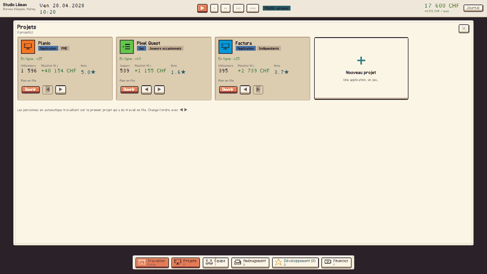

# Startup Rush

**Un tycoon de la tech en pixel art isométrique, pour Windows.** Tu démarres dans ta chambre de Prilly avec tes économies et une vieille tour. Tu crées tes propres applications et tes jeux, tu choisis leurs composants, tu y travailles toi-même au terminal, puis ton équipe les développe toute seule, tu lis les avis de tes utilisateurs et tu fais grandir ton empire. La partie est longue et sauvegardée. Elle continue tant que l'argent suit.



## Jouer

1. Décompresse `StartupRush-<version>-win-x64.zip`.
2. Lance `StartupRush.exe` (Windows 10 ou 11, 64 bits ; rien d'autre à installer).

Au lancement : **Continuer**, **Charger**, **Nouvelle partie**, **Réglages**, **Quitter**.

## En deux minutes

1. **Projets → Créer ton premier projet** : choisis Application ou Jeu, puis un public. C'est tout.
2. Au début, c'est toi qui travailles : **Travailler** (Entrée) ouvre le terminal, tu tapes les mots qui s'affichent, chacun fait avancer la tâche en cours. Environ 400 mots plus tard : **Lancer !** Ensuite, tes employés développent tout seuls.
3. Les utilisateurs arrivent. L'onglet **Avis** dit ce qui leur plaît et ce qui manque ; **Améliorer** t'emmène au bon composant.
4. Les succès rapportent des **points de développement** : de nouveaux types de projets, des serveurs plus gros, des canaux marketing, une équipe plus efficace.
5. Surveille l'argent en haut à droite. Embaucher, déménager ou dépenser en marketing trop tôt peut te mettre en faillite.

| Menu | Touche | Pour |
|---|---|---|
| Projets | P | Le portefeuille, l'atelier de composants, les avis, les réglages (prix, marketing, entretien, serveurs) |
| Équipe | T | Qui travaille sur quoi, congés, formation, augmentation, recrutement |
| Aménagement | B | Bureaux, ordinateurs, coins pause, déménagement |
| Développement | D | L'arbre de développement et les jalons |
| Finances | F | L'argent, la tendance, les dépenses ; les détails sont repliés |

Les règles complètes sont dans [DESIGN_SIMULATION.md](DESIGN_SIMULATION.md).

## Contrôles

| Touche ou geste | Action |
|---|---|
| Clic gauche | Sélectionner une personne ou un objet ; poser un meuble en aménagement |
| Entrée | Travailler au terminal (Espace ou Entrée y valident un mot) |
| R | Tourner le meuble à poser ou le meuble sélectionné |
| Clic droit | Annuler la pose ; maintenu : déplacer la vue |
| Molette, + / − | Zoom |
| Flèches ou WASD | Déplacer la vue (Origine : recentrer) |
| Espace | Pause |
| 1, 2, 3, 4 | Vitesse |
| P, T, B, D, F | Menus |
| N | Journal (problèmes à traiter, bonnes nouvelles, infos) |
| Échap | Ferme ce qui est ouvert, sinon ouvre la pause. Ne quitte jamais la partie. |
| F11 | Plein écran |

## Sauvegardes

Elles sont dans `%AppData%\StartupRush\campaigns\`, avec un dossier par campagne. Il y a des sauvegardes nommées, 3 sauvegardes automatiques tournantes et une sauvegarde de sortie. L'écriture est atomique et la copie précédente est conservée. Les parties de la version à prestations sont converties au chargement (l'original est gardé), et l'ancien profil du roguelike n'est pas touché. Détails dans [SAVES.md](SAVES.md).

## Construire

Il faut le SDK .NET 9.

```
dotnet build StartupRush.sln
dotnet test Tests/Tests.csproj
dotnet run --project UI
dotnet publish UI/UI.csproj -c Release -r win-x64 --self-contained true -p:PublishSingleFile=true -p:EnableCompressionInSingleFile=true -p:IncludeNativeLibrariesForSelfExtract=true -p:DebugType=none -o publish/StartupRush
```

Autres commandes :
- `python tools/build_assets.py` : regénère les ressources depuis `assets/`.
- `dotnet test Tests/Tests.csproj --filter Name=WriteBalanceReport` : réécrit `BALANCE_REPORT.md`.
- `StartupRush.exe --capture <dossier>` : joue un parcours dans le vrai jeu et enregistre des captures (`docs/captures/`).

Documents : [DESIGN_SIMULATION.md](DESIGN_SIMULATION.md), [SAVES.md](SAVES.md), [BALANCE_REPORT.md](BALANCE_REPORT.md), [VALIDATION.md](VALIDATION.md), [ASSET_USAGE.md](ASSET_USAGE.md), [FURNITURE_MANIFEST.md](FURNITURE_MANIFEST.md), [THIRD_PARTY_NOTICES.md](THIRD_PARTY_NOTICES.md), guide illustré `docs/Startup_Rush_Guide.pdf`.

## Limites connues

- **Testé seulement sur Windows 11 x64**, avec une mise à l'échelle de 100 %.
- **Équilibrage mesuré par des bots** (voir VALIDATION.md). Le plaisir de jeu n'a pas été validé par des humains.
- **Sons non écoutés** : ils se chargent et se déclenchent (vérifié), mais je ne les ai pas validés à l'oreille.
- **V1 en cours** (voir [docs/V1_ETAT.md](docs/V1_ETAT.md)) : lots 1 à 6 faits (isométrique, terminal, délégation, multisite et cloud, recherche, matériel et usine, IA, studio, XR, quantique). Reste le lot 7 : équilibrage mesuré, performance, accessibilité, version de sortie. Les écrans du lot 6 n'ont pas encore été vérifiés dans le vrai jeu.
- La police pixel est un peu floue à certaines tailles de texte.
