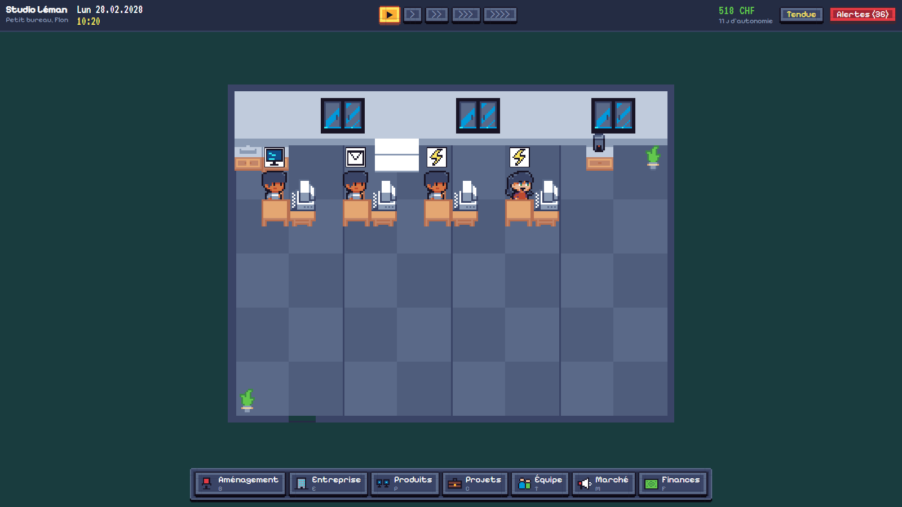

# Startup Rush

**Simulation d'entreprise tech en pixel art, pour Windows.** Tu démarres dans ton appartement de Prilly avec 7 000 CHF et un vieux portable. Tu signes des prestations pour vivre, tu construis tes propres produits page par page, tu recrutes, tu aménages, tu déménages dans de vrais locaux. La campagne est longue, sauvegardée, et elle continue tant que l'entreprise paie ses factures. Si elle ne les paie plus, elle finit liquidée.



## Jouer

1. Décompresse `StartupRush-<version>-win-x64.zip`.
2. Lance `StartupRush.exe` (Windows 10 ou 11, 64 bits ; rien d'autre à installer).

Au lancement : **Continuer** (la dernière sauvegarde), **Charger**, **Nouvelle partie**, **Réglages**, **Quitter**.

## Ce qu'on fait

- **Aménagement** : acheter et poser bureaux, chaises, ordinateurs, coins pause, plantes. Un poste ne compte que s'il est complet et accessible. L'appartement prend 3 postes ; ensuite, il faut louer.
- **Projets** : étudier les demandes de clients, négocier le délai (sûr, standard, rapide), livrer à temps et à la qualité attendue, puis attendre que la facture soit payée.
- **Produits** : créer un outil SaaS, une app communautaire ou une place de marché ; construire ses pages et ses modules dans l'éditeur, lancer le développement, publier, puis piloter prix, serveurs, marketing et support. Le menu Résultats explique pourquoi les chiffres bougent.
- **Équipe** : recruter, affecter chaque personne à une seule chose, former, nommer des responsables, surveiller énergie et moral.
- **Marché** : publics, concurrents (qui annoncent leurs nouvelles versions), budgets marketing.
- **Finances** : trésorerie, créances, dettes, autonomie, résultat mensuel, prêt, investisseur, plan de redressement.
- **Entreprise** : réputation, entreprises du groupe, jalons.

Les règles complètes sont dans [DESIGN_SIMULATION.md](DESIGN_SIMULATION.md).

## Contrôles

| Touche ou geste | Action |
|---|---|
| Clic gauche | Sélectionner une personne ou un objet ; poser un meuble en mode aménagement |
| Clic droit | Annuler l'outil de pose ; maintenu : déplacer la vue |
| Molette | Zoom |
| Flèches ou WASD | Déplacer la vue (Origine : recentrer) |
| + / − | Zoom |
| Espace | Pause |
| 1, 2, 3, 4 | Vitesse |
| B, E, P, C, T, M, F | Aménagement, Entreprise, Produits, Projets, Équipe, Marché, Finances |
| N | Journal des notifications |
| Échap | Ferme la fenêtre ou le menu ouvert, puis ouvre la pause (jamais ne quitte la partie) |
| F11 | Plein écran |

## Sauvegardes

Dans `%AppData%\StartupRush\campaigns\` : un dossier par campagne, sauvegardes nommées, 3 sauvegardes automatiques tournantes (chaque lundi de jeu), et une sauvegarde de sortie écrite en quittant. Écriture atomique, copie précédente gardée, fichiers abîmés signalés et jamais effacés. L'ancien profil du roguelike n'est pas touché. Détails : [SAVES.md](SAVES.md).

## Construire le jeu

Il faut le SDK .NET 9 (et Python avec Pillow seulement pour regénérer les ressources).

```
dotnet build StartupRush.sln
dotnet test Tests/Tests.csproj
dotnet run --project UI
```

Archive Windows autonome :

```
dotnet publish UI/UI.csproj -c Release -r win-x64 --self-contained true -p:PublishSingleFile=true -p:EnableCompressionInSingleFile=true -p:IncludeNativeLibrariesForSelfExtract=true -p:DebugType=none -o publish/StartupRush
```

Autres commandes :

- `python tools/build_assets.py` : regénère `UI/Assets` (atlas, sons, cadres) depuis les packs de `assets/`.
- `dotnet test Tests/Tests.csproj --filter Name=WriteBalanceReport` : rejoue la campagne d'équilibrage et réécrit `BALANCE_REPORT.md` (environ 1 min 30).
- `StartupRush.exe --capture <dossier>` : parcours scripté dans le vrai jeu, qui enregistre des captures et un rapport de contrôle (`docs/captures/`). Les sauvegardes de ce parcours vont dans un dossier temporaire à part.

## Projet

| Dossier | Contenu |
|---|---|
| `Core` | Toute la simulation, sans interface |
| `UI` | Interface Avalonia : scène, menus, sons |
| `Tests` | Tests NUnit, scénarios, campagne d'équilibrage |
| `tools` | Fabrication des ressources |
| `assets` | Packs originaux (non versionnés) |

Documents : [DESIGN_SIMULATION.md](DESIGN_SIMULATION.md) (règles et réglages), [SAVES.md](SAVES.md) (format de sauvegarde), [BALANCE_REPORT.md](BALANCE_REPORT.md) (mesures), [VALIDATION.md](VALIDATION.md) (vérifications et limites), [ASSET_USAGE.md](ASSET_USAGE.md), [FURNITURE_MANIFEST.md](FURNITURE_MANIFEST.md), [THIRD_PARTY_NOTICES.md](THIRD_PARTY_NOTICES.md).

L'ancien roguelike est archivé dans git sous le tag `archive/roguelike-v1`.

## Limites connues

- **Testé seulement sur Windows 11 x64.**
- **Équilibrage mesuré par des bots**, pas par des humains (voir VALIDATION.md). Sur 18 mois, une agence bien gérée rapporte encore plus qu'un produit ; les produits paient plus tard.
- **Sons non écoutés** : chargés et déclenchés (vérifié), mais pas validés à l'oreille.
- **Pas de rotation des meubles** : les sprites n'existent que de face.
- **Archétypes** studio de jeux et infrastructure : pas développés.
- Sur une page, les modules s'ajoutent à la fin puis se réordonnent avec ↑ ↓ (pas de glisser-déposer).
